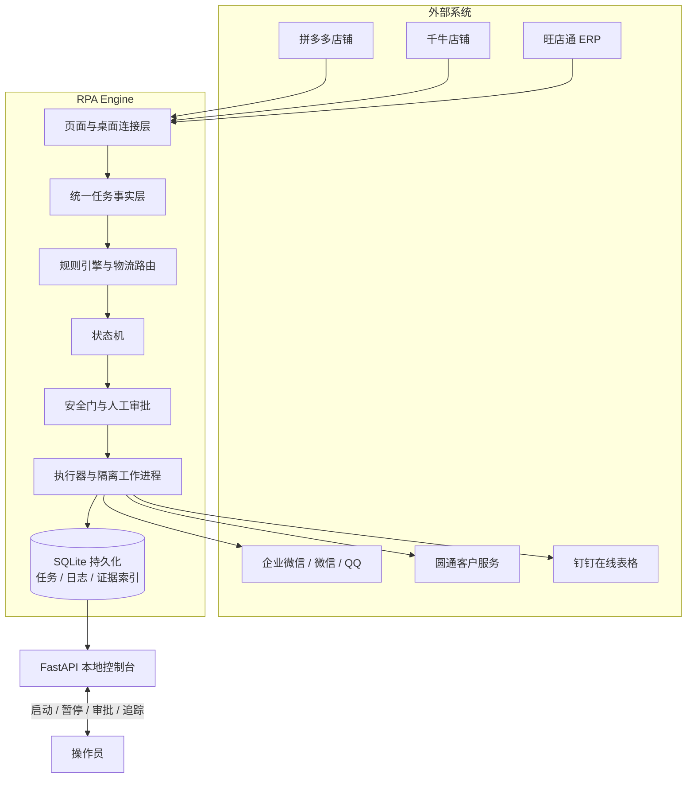

# Multi-shop After-sales RPA

[](https://github.com/kyirejson/pdd-aftersales-rpa/actions/workflows/core-tests.yml)


> 面向多店铺电商售后场景的 Windows RPA 系统：融合 UIA、Playwright、规则引擎与状态机，覆盖工单采集、ERP 查询、物流路由、人工审批、消息通知、结果核验与审计追踪。
>
> A Windows-first RPA system for multi-shop after-sales operations, combining desktop automation, browser automation, rule-based routing, explicit approvals, idempotent execution and auditable evidence.

## 在线前端演示

直接打开项目真实前端页面（静态只读演示，使用合成数据）：

- [售后流程控制台](https://kyirejson.github.io/pdd-aftersales-rpa/app/index.html)
- [可视化流程设计器](https://kyirejson.github.io/pdd-aftersales-rpa/app/designer.html)
- [在途退款路由配置](https://kyirejson.github.io/pdd-aftersales-rpa/app/routing.html)

> 演示副本保留原页面结构、样式和点击交互，仅通过只读 mock 适配层提供合成任务；不会连接真实店铺、数据库或桌面客户端。


## 项目亮点

- **完整业务闭环**：从多店铺工单/售后扫描，到 ERP 查询、物流路由、外部消息、退款/驳回和结果回核。
- **混合自动化架构**：Edge DOM/UIA、Windows 桌面 UIA、OCR 校验、Playwright CDP 与独立工作进程协同。
- **安全优先**：默认 `OBSERVE` 模式并关闭真实外部写操作；真实动作需同时满足模式、总开关、店铺/Profile、群白名单和审批要求。
- **可审计、可恢复**：SQLite 持久化任务状态机、动作日志、幂等键和证据索引；重启后不重复执行已验证成功的动作。
- **自带操作界面**：本地控制台、可视化流程设计器、在途退款路由配置和处理历史追踪。
- **发布版已脱敏**：仓库不包含真实数据库、订单截图、浏览器登录态、控制台密钥或生产配置文件。

## 界面预览

| 控制台 | 流程设计器 | 路由配置 |
| --- | --- | --- |
|  |  |  |

更多界面说明见 [docs/INTERFACE.md](docs/INTERFACE.md)。以上截图中的店铺、订单、金额、物流单号和群组均为合成示例数据。

## 架构



架构细节见 [docs/ARCHITECTURE.md](docs/ARCHITECTURE.md)。

## 核心能力

- 多店铺独立浏览器 Profile 的列表扫描、详情读取和页面身份核验；
- 售后类型、退款原因、物流轨迹和可用按钮驱动的规则决策；
- 仓库、快递、商品关键词到消息平台和群组的路由配置；
- 旺店通订单、仓库、物流公司和商品信息查询；
- 高风险桌面动作拆分为原子组件，由独立进程和超时边界执行；
- 全局暂停、失败熔断、人工复核、审批和操作日志；
- 截图证据、处理历史、导出和跨来源任务追踪。

## 快速开始

> 当前项目面向 **Windows + Python 3.13**。默认配置不含真实账号，也不会执行真实外部写操作。

```powershell
# 1. 创建虚拟环境
py -3.13 -m venv .venv

# 2. 安装依赖
.\.venv\Scripts\python.exe -m pip install -r requirements.txt

# 3. 创建本地配置
Copy-Item .\config\settings.example.json .\config\settings.json

# 4. 初始化数据库与规则；首次运行会生成一次随机控制台密码
.\.venv\Scripts\python.exe -m pdd_rpa.cli init

# 5. 启动控制台
.\.venv\Scripts\python.exe -m pdd_rpa.cli serve --host 127.0.0.1 --port 8876
```

打开 `http://127.0.0.1:8876/`，使用初始化时输出的随机密码登录。日常使用也可以双击 `启动控制台.cmd`。

## 安全边界

发布版默认配置已经做到：

- `execution_mode = "observe"`；
- `live_actions_enabled = false`；
- 消息平台、千牛生产流程、售后工作台生产和钉钉登记均未启用；
- 店铺、群组、仓库和内部文档地址均为占位符；
- 控制台密钥、SQLite 数据库和证据截图都位于 `runtime/`，并被 `.gitignore` 排除。

不要把真实 `config/settings.json`、`runtime/`、浏览器用户目录、账号凭据或业务截图提交到仓库。安全设计详见 [docs/SECURITY.md](docs/SECURITY.md)。

## 测试

```powershell
.\.venv\Scripts\python.exe -m pip install -r requirements-dev.txt
.\.venv\Scripts\python.exe -m pytest -q
```

当前测试覆盖规则引擎、状态机、安全门、幂等持久化、浏览器/桌面执行器、消息路由和主要工作流。部分测试针对 Windows 桌面自动化编写，建议在本机开发环境完整运行；CI 中优先执行核心单元测试。

## 目录结构

```text
pdd_rpa/                 核心 Python 包
  connectors/            平台连接器和消息连接器
  static/                控制台、设计器和路由配置前端
config/
  settings.example.json  安全的示例配置
  rules.json             规则引擎示例规则
docs/
  ARCHITECTURE.md        架构说明
  INTERFACE.md           界面说明
  SECURITY.md            安全边界说明
  assets/                脱敏界面截图
scripts/                 诊断与工程辅助脚本
tests/                   自动化测试
```

## 配置说明

- 从 `config/settings.example.json` 复制出本地 `config/settings.json`；
- 将示例店铺替换为真实店铺 ID、显示名和 Edge Profile；
- 按环境配置旺店通、消息平台、圆通和钉钉连接；
- 生产启用前逐项完成 [docs/SECURITY.md](docs/SECURITY.md) 中的验收清单。

## 发布说明

本仓库是从生产迁移包中提炼出的**源码级发布副本**：保留核心系统、测试、文档和界面，移除真实业务数据与一键生产执行入口。清理范围与复核方法见 [docs/PUBLIC_RELEASE.md](docs/PUBLIC_RELEASE.md)。

当前未附带开源许可证；在明确权利归属并选择许可证前，请按私有/展示仓库使用，不要默认视为可自由再分发的开源软件。
