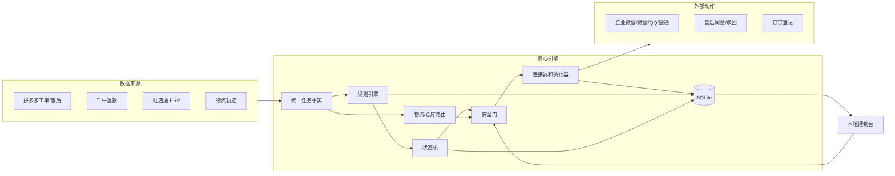

# 架构说明

## 设计目标

系统解决的不是“模拟点击”单点问题，而是多店铺、多桌面客户端、多平台消息链路上的售后处理一致性问题：

1. 从多个店铺和平台稳定读取同一业务事实；
2. 用显式状态机约束处理顺序；
3. 把高风险外部动作放入安全门和审批链；
4. 让每个外部写动作可幂等、可审计、可恢复。

## 总体分层

### 1. 页面与连接层

- 拼多多与千牛：Edge 页面读取、标签页治理、登录恢复和页面身份核验；
- 旺店通：Windows 桌面 UIA、固定组件 OCR 和坐标兜底；
- 消息平台：企业微信、微信、QQ 和圆通客户服务窗口的白名单定位与发送后回读；
- 钉钉：Playwright 驱动在线表格登记；
- 每个高风险客户端通过独立工作进程隔离，并设置超时与立即终止机制。

### 2. 事实层

不同来源的数据被转换为统一的 `WorkOrderFacts`，包括店铺、订单、售后单、退款类型、金额、物流、ERP 查询结果和来源证据。页面身份、原始字段和同步批次随事实一起保存，避免控制台展示与后续决策使用两套数据。

### 3. 规则与路由层

- 规则引擎按平台、店铺、退款类型、物流状态、ERP 状态和人工配置求值；
- 在途退款路由按仓库、快递和商品关键词选择目标平台、账号和群组；
- 规则配置与执行代码分离，支持启停、优先级和审批要求。

### 4. 流程与执行层

状态机定义采集、规则匹配、就绪、审批、执行、核验、完成和人工处理之间的合法迁移。执行器把桌面动作拆成可核验的原子步骤，例如激活窗口、断言身份、点击元素、输入文本、等待状态、读取结果和保存证据。

### 5. 持久化与审计层

SQLite 保存：

- 当前任务和历史任务；
- 动作日志与状态迁移；
- 规则、组件、流程和路由配置；
- 截图证据索引；
- 全局暂停、运行状态和恢复信息。

业务键、订单号、售后单号和动作类型共同构成幂等边界。已验证成功的外部动作不会在重启后重复执行。

### 6. 控制层

FastAPI 本地控制台提供：

- 启动、停止、暂停和恢复；
- 工单池、处理历史和证据查看；
- 流程设计器和组件定义；
- 路由配置、规则启停和审批处理；
- 控制台登录和会话保护。

## 浏览器与桌面隔离

- 每个店铺通过独立 Edge Profile 和完整显示名进行双重核验；
- 千牛、圆通和钉钉使用项目内相互隔离的浏览器用户目录；
- 当 URL、窗口标题、店铺名、前台窗口和 Profile 无法同时匹配时，物理输入会被拒绝；
- 同一桌面客户端同一时间只允许一个受控动作；
- 浏览器登录态、本地数据库和控制台密钥不进入仓库。

## 主要业务链路

### 多店铺工单

逐店扫描工单列表，读取详情、退款原因、物流状态和可用动作；结合规则与旺店通结果进入等待、拦截、同意、驳回或人工处理。

### 千牛未收货退款

拼多多扫描后进入独立千牛窗口，读取未收货退款列表和详情，查询 ERP 与物流轨迹，再按状态执行后续动作。千牛任务使用独立来源标识和证据类型。

### 物流拦截与消息

在途售后按路由配置找到目标快递、供应商或仓库群组；发送前后都校验窗口身份、群名和回读证据。成功拦截后写入登记表，并用幂等键防止重复登记。

## 恢复策略

- 页面或工作进程超时：任务进入重试或人工审核；
- 连续失败：触发失败熔断和全局暂停；
- 外部写入结果不确定：标记为待复核，不自动假设成功；
- 服务重启：从 SQLite 恢复任务与运行状态，继续未完成的内部步骤，但不重复已验证成功的外部写动作。

## 发布版边界

本仓库保留架构、源码、测试和安全机制，不包含生产数据库、真实截图、登录态、真实店铺配置或一键生产入口。真实部署应由操作员重新创建本地配置、浏览器 Profile、外部账号和控制台密钥。
