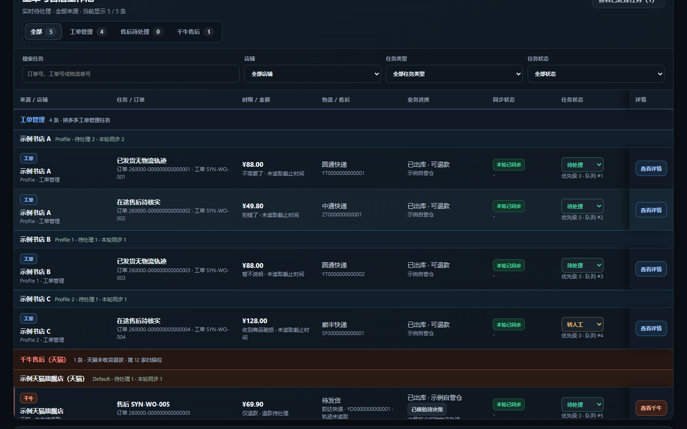
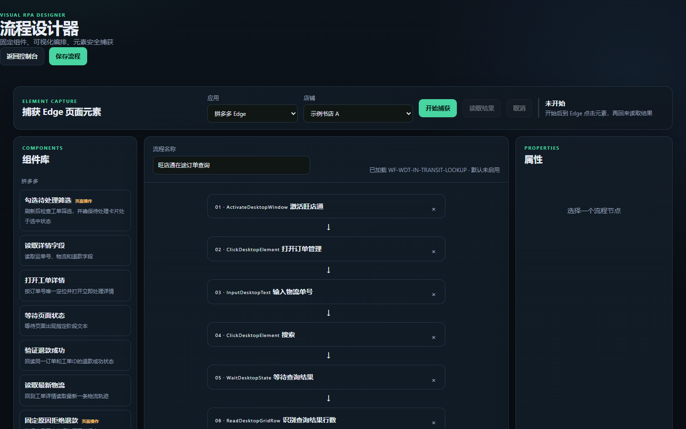
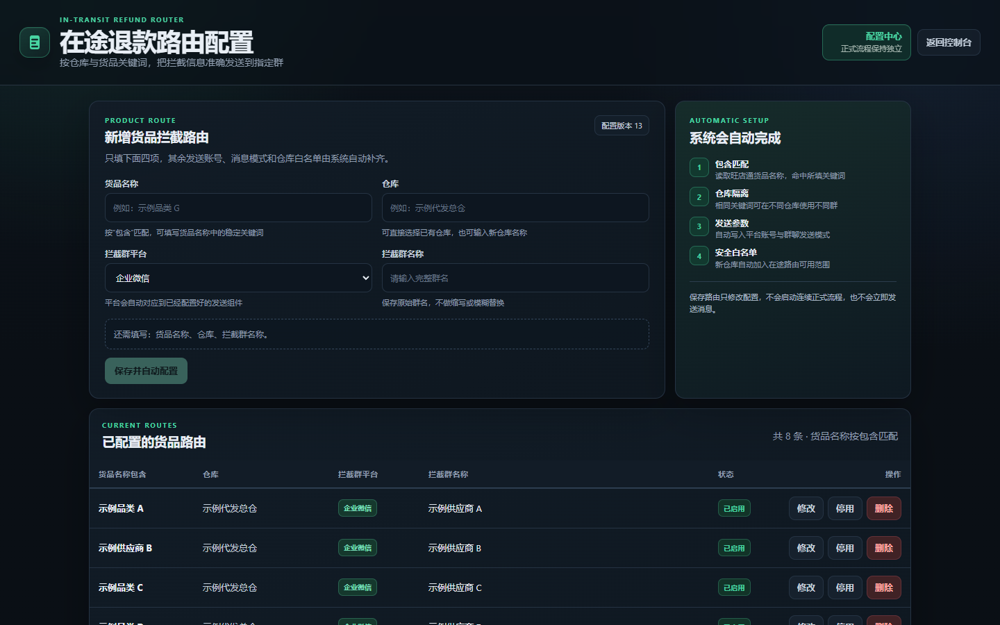

# 界面说明

仓库中的界面截图均由本地演示环境生成，页面数据为合成示例，不包含真实店铺、订单、客户、手机号、内部文档地址或本机路径。

## 售后流程控制台



控制台集中展示：

- 当前运行模式与真实操作总开关；
- 正式运行控制、单轮处理、全局暂停和立即停止；
- 实时待处理、工单管理、售后工作台和千牛售后数量；
- 工单池筛选、来源切换、任务状态、同步状态和处理优先级；
- 任务详情、ERP 查询结果、物流状态、规则和证据入口。

## 可视化流程设计器



设计器用于把桌面和页面动作编排为可审计流程：

- 左侧是浏览器、桌面、页面、等待和证据组件库；
- 中间是节点顺序和连接关系；
- 右侧展示选中节点的属性；
- 支持从 Edge 捕获页面元素并保存为组件定义。

发布版中的流程默认不启用，避免未验收组件被自动执行。

## 在途退款路由配置



路由页用于维护仓库、快递和商品关键词到消息群组的映射：

- 按货品名称关键词匹配路由；
- 选择仓库、消息平台和目标群组；
- 展示当前启用的路由列表；
- 修改配置只影响后续决策，不会直接触发消息发送。

截图中的“示例品类”“示例供应商”“示例代发总仓”均为占位数据。

## 本地访问

```powershell
.\.venv\Scripts\python.exe -m pdd_rpa.cli serve --host 127.0.0.1 --port 8876
```

首次初始化会自动生成随机控制台密码，密码只显示一次，保存在被 Git 忽略的 `runtime/console_access.json` 中。
